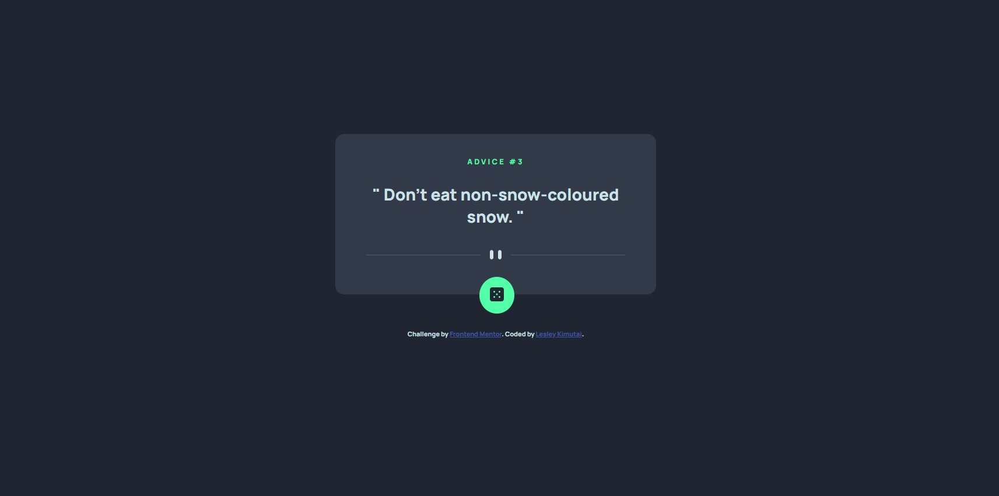
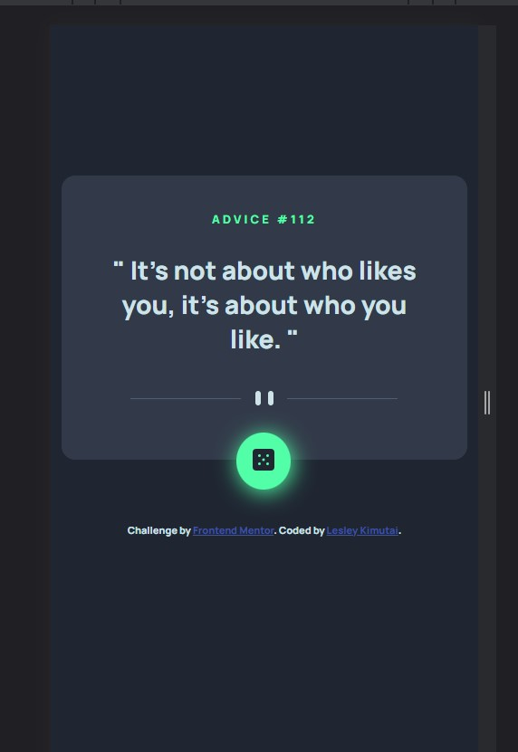
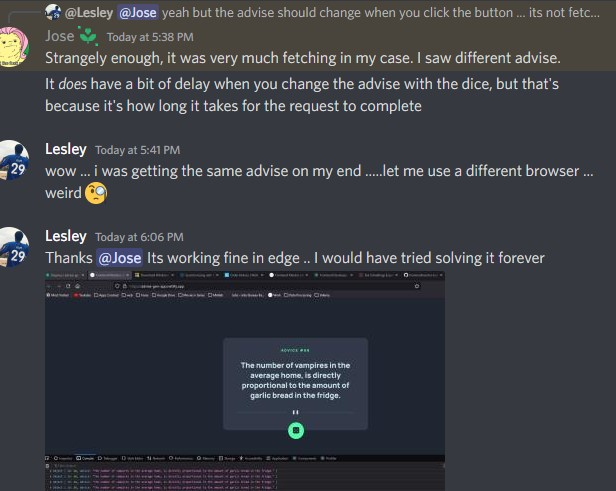

# Frontend Mentor - Advice generator app solution

This is a solution to the [Advice generator app challenge on Frontend Mentor](https://www.frontendmentor.io/challenges/advice-generator-app-QdUG-13db). Frontend Mentor challenges help you improve your coding skills by building realistic projects.

## Table of contents

- [Overview](#overview)
  - [The challenge](#the-challenge)
  - [Screenshot](#screenshot)
  - [Links](#links)
- [What changed — November 23, 2026 rebuild](#what-changed--november-23-2026-rebuild)
  - [TypeScript port](#typescript-port)
  - [New features](#new-features)
  - [Favourites backend + database](#favourites-backend--database)
  - [How to run](#how-to-run)
  - [Known limits](#known-limits)
- [My process](#my-process)
  - [Built with](#built-with)
  - [What I learned](#what-i-learned)
  - [Continued development](#continued-development)
- [Author](#author)
- [Acknowledgments](#acknowledgments)

## Overview

### The challenge

Users should be able to:

- View the optimal layout for the app depending on their device's screen size
- See hover states for all interactive elements on the page
- Generate a new piece of advice by clicking the dice icon

### Screenshot

> Screenshots below are from the original JavaScript version. New screenshots
> of the November 23, 2026 rebuild are still pending — the headless Chromium
> on the build machine would not start (Hatch WebGL domain policy error), so
> no new screenshots could be captured here. They will be added to
> `docs/screenshots/` when they are taken.

Laptop and Tablet View Modes


Mobile View of the Advice app


### Links

- Solution URL: [Github Link](https://github.com/issagoodlifeInc/advice-gen-app.git)
- Live Site URL: [Advice Generator](https://advise-gen-app.netlify.app/) (still serves the old version — see [Known limits](#known-limits))

## What changed — November 23, 2026 rebuild

The app was rebuilt from plain JavaScript React to TypeScript React, and
levelled up from a front-end-only challenge into a small full-stack app.
Full detail is in [BUILD_REPORT.md](./BUILD_REPORT.md).

### TypeScript port

- `src/App.js` → `src/App.tsx`, `src/index.js` → `src/index.tsx`,
  `src/components/Footer.js` → `src/components/Footer.tsx`
- Strict `tsconfig.json`, plus `src/react-app-env.d.ts` for SVG imports
- `typescript`, `@types/react` and `@types/react-dom` added as
  devDependencies. Still Create React App / `react-scripts` — no framework
  switch.
- Fixed a bug from the original: `setAdvice(fetchData())` stored a promise
  instead of the advice slip. Fetching now uses `async/await` properly.

### New features

- **No headline at the top.** Just the language switch, stretched
  end-to-end, with English / Kiswahili / Kalenjin as equal thirds.
- **Dice-only new advice.** The dice button is the only way to get a new
  slip, and the same advice never comes up twice in a row (retries up to
  3 times). Loading skeleton, error box with retry, and clearly-labelled
  example slips if the API can't be reached on first load.
- **Kiswahili, auto-translated.** Swahili comes from MyMemory (en → sw)
  and is cached by Advice ID, so the same slip is never re-translated.
  24 seeded translations cover the common advice IDs
  (`src/data/swahiliCache.ts`). If translation fails, English (the source)
  stays shown, with a note.
- **Kalenjin — one AI-drafted example only.** The Kalenjin button scrolls
  to a draft section; it is not a live advice language. The example is
  *"Don't keep all your eggs in one basket."* →
  *"Matiny maaiyeguk tugul eng' itoget ake."*, marked **"AI-drafted —
  awaiting human review"**, with the grain/granary cultural note and the
  Swahili reference *"Usiweke mayai yako yote kwenye kikapu kimoja"*.
  No Kalenjin text is stored in favourites.
- **Bible Advice.** A button shows an NIV verse matched to the current
  advice by topic keywords (18 verses in `src/data/bibleVerses.ts`). If
  nothing matches closely, a random verse is shown instead, with a note
  saying so. Copy verse included.
- Below the card, the only actions are **Save, Copy, Share, Bible Advice**.

### Favourites backend + database

Favourites no longer live only for the session — they are saved in a real
database through a small backend in `server/` (Express + Node's built-in
`node:sqlite`, Node 24).

- Table: `favourites(advice_id INTEGER PRIMARY KEY, advice_en TEXT NOT NULL, advice_sw TEXT, created_at TEXT)` — deliberately no Kalenjin column.
- API: `GET /api/favourites` · `POST /api/favourites`
  `{adviceId, adviceEn, adviceSw?}` (saving the same advice twice updates
  it, doesn't duplicate) · `DELETE /api/favourites/:adviceId` ·
  `DELETE /api/favourites`
- The React app calls this API (see `src/api/favourites.ts`). If the
  server isn't running, the app says so — it does **not** silently fall
  back to localStorage.
- `server/favourites.db` is gitignored — it's your data, not code.

### How to run

```bash
npm install          # app dependencies
npm start            # dev server, http://localhost:3000

cd server
npm install          # backend dependencies
node index.js        # favourites server on http://localhost:5001
```

Or from the app folder: `npm run server` runs the backend. Run both
together in development — favourites only work while the server is running.
`npm run build` produces the production build (`tsc --noEmit` clean,
build compiles successfully).

### Known limits

- **MyMemory free quota** was exhausted when tested (shared-IP daily
  limit). The app refuses to cache MyMemory's quota-warning text as a
  translation. Seeded translations still work; new ones resume when the
  quota resets.
- **Not yet browser click-through tested.** The build was verified by
  serving it and testing the API with curl (all 4 endpoints, Advice Slip
  live), but the dice, language switch, Save and Bible Advice buttons have
  not had a manual tap-through in a browser yet. Do that before merging
  to `master`.
- **Netlify can't run the SQLite server as-is.** The live site
  (`advise-gen-app.netlify.app`) still serves the old version. Deploying
  the frontend + backend together needs a decision (e.g. a hosted database
  / backend host) — this branch does not deploy anywhere.

## My process

- Initialized git the required `react`, `react-dom`, `react-scripts` for the app
- Set up the public and src folders and their respective files/ folders
- Tweaked the `package.json` to be able to `build` and `start` the app using `react-scripts`

  ```js
  "scripts": {
  "start": "react-scripts start",
  "build": "react-scripts build",
  },
  "eslintConfig": {
  "extends": [
    "react-app",
    "react-app/jest"
  ]
  }
  <!-- Tweak eslint config to remove import error -->
  <!-- Setting CI=false removes build error where warnings are taken as an error -->

  ```

- Set up the `index.html,.js styles.css,App.js` and all Footer Component
- Worked on the `main` part of the advice gen the styled
- Required `axios` and used it to get random advices that were saved to state using `useState`
- Used `useEffect` to change the divider image according to the screen width
- Added a click function to the button to generate a new advice when clicked
- Deployed it then came here to write this up

-Get request not working well on Mozilla though

### Built with

- Semantic HTML5 markup
- CSS custom properties
- Flexbox
- CSS Grid
- Laptop-first workflow
- [React](https://reactjs.org/) - JS library
- [Axios](https://www.npmjs.com/package//axios) - Promise based HTTP client for the browser
- [TypeScript](https://www.typescriptlang.org/) - since the November 23, 2026 rebuild
- [Express](https://expressjs.com/) + [SQLite](https://www.sqlite.org/) (`node:sqlite`) - favourites backend, since the November 23, 2026 rebuild

### What I learned

Code I'm proud of + Things I learnt

- Ussing useEffect to change divider image and also get response from the advice url

```js
// Changing the divider image as per teh screen width dynamically
const [width, setWidth] = React.useState(window.innerWidth);

const [advice, setAdvice] = React.useState({});

const updateDimensions = () => {
  setWidth(window.innerWidth);
};
useEffect(() => {
  window.addEventListener("resize", updateDimensions);
  setAdvice(fetchData());
}, []);

= 580 ? divider : dividermobile} alt="dividerline" />;
```

- Getting data through axios

```js

 const fetchData = async () => {
    await axios.get(url).then((res) => {
      console.log(res.data.slip);
      setAdvice(res.data.slip);
      return res.data.slip;
    });
  };
// Function to fetch new data from url
  const getAdvice = () => {
    fetchData();
    console.log(advice);
  };
        <button onClick={getAdvice} className="btn--advice">

```

### Continued development

Learn more React usage and best practices

- Like using `useEffect` {The first time using it, invoked the `fetchData` function on the dependancy part creating a forever loop on one of my deploys before knowing what I hade done}
- Learn more on using useState in React

Better turnaround time

## Author

- Website - [Lesley Kimutai](https://leskimfamily.herokuapp.com/)
- Frontend Mentor - [@Leskim](https://www.frontendmentor.io/profile/Leskim)
- Twitter - [@KimutaiLesley](https://twitter.com/KimutaiLesley)

## Acknowledgments

@Jose From Scrimba Discord #react-help channel - Helped me know the onclick function was working fine just my Firefox that wasn't getting new advice

